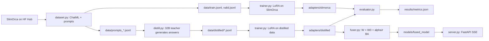

# QLoRA-Distill: Local LLM Fine-Tuning, Distillation & Adapter Fusion on Apple Silicon

[](https://github.com/YOUR_USERNAME/peft-qlora-engine/actions)
[](https://www.python.org/)
[](https://github.com/ml-explore/mlx)

An end-to-end, fully local pipeline that:

1. fine-tunes a 4-bit 7B model with **LoRA (QLoRA-style)** on a Mac using [MLX](https://github.com/ml-explore/mlx),
2. **distills** a larger 32B teacher into the 7B student (sequence-level distillation),
3. **evaluates** every variant (perplexity, peak memory, generation speed),
4. **fuses** the adapters into the base weights, and
5. **serves** the result over a streaming (SSE) FastAPI endpoint.

It uses only open weights, open datasets and open-source libraries, and needs no cloud GPU.

---

## Table of contents
- [Architecture](#architecture)
- [Mathematical foundations](#mathematical-foundations)
- [Memory budget](#memory-budget)
- [Data pipeline](#data-pipeline)
- [Distillation](#distillation)
- [Repository layout](#repository-layout)
- [Setup and usage](#setup-and-usage)
- [Configuration](#configuration)
- [Streaming API](#streaming-api)
- [Results](#results)
- [Testing](#testing)
- [Design decisions and limitations](#design-decisions-and-limitations)

---

## Architecture

### Pipeline



### LoRA layer

```
                  Input x (k-dim)
                   │          │
        ┌──────────┘          └───────────┐
        ▼                                 ▼
 [ Frozen base W0 (d x k) ]       [ Trainable A (r x k) ]
   (4-bit quantized)                      │
        │                                 ▼
        │                         [ Trainable B (d x r) ]
        │                                 │
        │                                 ▼
        │                         [ scale alpha / r ]
        │                                 │
        └──────────────► (+) ◄────────────┘
                          │
                      output h (d-dim)
```

### Components

| Module | Responsibility |
| :--- | :--- |
| `config.py` | Pydantic settings, overridable through env vars or `.env` |
| `dataset.py` | Streams SlimOrca, formats ChatML, writes train/valid JSONL and prompt files |
| `distill.py` | Teacher inference, resumable, writes the distilled ChatML dataset |
| `trainer.py` | Generates the MLX LoRA YAML config and runs `mlx_lm.lora` |
| `evaluator.py` | Perplexity, peak memory and tokens/sec per variant, merged into `metrics.json` |
| `fuser.py` | `mlx_lm.fuse` wrapper plus a NumPy reference implementation of the merge |
| `server.py` | FastAPI app streaming tokens over Server-Sent Events |

---

## Mathematical foundations

### 1. Low-Rank Adaptation (LoRA)

For a frozen pretrained weight $W_0 \in \mathbb{R}^{d \times k}$, full fine-tuning learns a dense update $\Delta W \in \mathbb{R}^{d \times k}$. LoRA constrains the update to rank $r \ll \min(d,k)$:

$$\Delta W = \frac{\alpha}{r} B A, \qquad B \in \mathbb{R}^{d \times r}, \quad A \in \mathbb{R}^{r \times k}$$

$$h = W_0 x + \Delta W x = W_0 x + \frac{\alpha}{r} B A x$$

- **Initialization:** $A$ is random Gaussian and $B = 0$, so $\Delta W = 0$ at step 0 and training starts from the pretrained model.
- **Trainable parameters per adapted matrix:** $r(d+k)$ instead of $dk$. For $d = k = 4096$ and $r = 16$ that is $131{,}072$ versus $16{,}777{,}216$, about $0.8\%$.
- **Scaling:** the factor $\alpha / r$ keeps the update magnitude roughly constant when $r$ changes, so the learning rate needs little re-tuning. This repo uses $r = 16$ and $\alpha = 32$, so the scale is $2$. MLX multiplies the adapter output directly by `scale`, so `trainer.py` passes `scale = alpha / rank`.
- **Gradients and optimizer state** exist only for $A$ and $B$. AdamW stores two moments per trainable parameter, so optimizer memory is negligible compared with full fine-tuning.

### 2. Quantized base weights (QLoRA)

The frozen $W_0$ is stored in 4-bit. During the forward pass each layer dequantizes its weights on the fly and applies the LoRA branch in higher precision. Gradients flow through the dequantized weights into $A$ and $B$ only.

In the original QLoRA paper the 4-bit format is **NormalFloat4 (NF4)**: 16 levels placed at quantiles of $\mathcal{N}(0,1)$,

$$q_i = \tfrac{1}{2}\left(Q_X\left(\tfrac{i}{16}\right) + Q_X\left(\tfrac{i+1}{16}\right)\right),$$

with **double quantization** that stores the per-block scales (block size 64) in 8 bits with a second-level block size of 256. Per-parameter metadata overhead drops from $32/64 = 0.5$ bits to

$$\frac{8}{64} + \frac{32}{64 \cdot 256} \approx 0.127 \text{ bits}.$$

> **Important:** MLX does not implement NF4 or double quantization. It uses group-wise **affine** 4-bit quantization (`w ≈ scale * q + bias` per group, typically group size 64). The LoRA mathematics is identical, but the numbers in this subsection describe the paper's scheme, not this repo's quantizer.

### 3. Adapter fusion

Matrix multiplication distributes over addition, so

$$W_0 x + \tfrac{\alpha}{r} B A x = \left(W_0 + \tfrac{\alpha}{r} B A\right) x = W_{\text{fused}} x.$$

`fuser.py` computes $W_{\text{fused}}$ once, so inference needs no extra matmuls. `fuse_weights()` is a NumPy reference implementation, and the unit tests check that the fused output equals the adapter forward pass. When the base is 4-bit, `mlx_lm.fuse` re-quantizes the merged weights, which introduces a small rounding error. Use `--dequantize` to export full-precision merged weights.

### 4. Training objective

Standard next-token cross-entropy over a ChatML sequence $x_{1:T}$:

$$\mathcal{L} = -\frac{1}{T-1}\sum_{t=1}^{T-1} \log p_\theta(x_{t+1} \mid x_{\le t}).$$

### 5. Perplexity

$$\text{PPL} = \exp\left(\frac{1}{N}\sum_{i=1}^{N} -\log p_\theta(x_i \mid x_{\lt i})\right)$$

`evaluator.py` accumulates the summed negative log-likelihood and token count over the validation set and applies this formula. Lower is better. Perplexity is computed over all tokens, including system and user text, and sequences are truncated to `--max-len` (default 1024).

### 6. Sequence-level distillation

Instead of matching teacher logits, the student is trained with ordinary cross-entropy on text sampled from the teacher $p_T$:

$$\hat{y} \sim p_T(\cdot \mid x), \qquad \min_\theta -\log p_\theta(\hat{y} \mid x).$$

This approximates minimizing $\mathrm{KL}(p_T \Vert p_\theta)$ over sequences. It is simpler than logit-level distillation and needs only the teacher's generated text, not its logits.

---

## Memory budget

Rough estimates for a 7B 4-bit model with rank 16 (actual numbers will be measured and reported below):

| Component | Approx. size |
| :--- | :--- |
| 4-bit base weights | 4 to 5 GB |
| LoRA adapters (r=16, 16 layers, fp16/bf16) | tens of MB |
| Optimizer state (adapters only) | tens of MB |
| Activations (batch 4, seq 2048, gradient checkpointing) | several GB |
| KV cache at inference | grows with context length |

Gradient checkpointing is enabled by default. The 32B teacher needs about 18 GB, and teacher and student are never loaded together.

---

## Data pipeline

- **Dataset:** [`Open-Orca/SlimOrca`](https://huggingface.co/datasets/Open-Orca/SlimOrca), streamed. Each row has a `conversations` list of `{from, value}` turns with roles `system`, `human` and `gpt`.
- **Format:** ChatML, which is the native format of the Qwen2.5 models.

```text
<|im_start|>system
You are an expert AI assistant that thinks step-by-step.<|im_end|>
<|im_start|>user
Write a function to implement binary search in Python.<|im_end|>
<|im_start|>assistant
Here is the binary search implementation...<|im_end|>
```

- **Split:** the first 5000 rows by default, 90% train and 10% validation, written to `data/train.jsonl` and `data/valid.jsonl` as `{"text": ...}` lines. `prompts_train.jsonl` and `prompts_valid.jsonl` hold the system and first user message for the teacher.

---

## Distillation

1. `distill.py` loads the teacher (`Qwen2.5-32B-Instruct-4bit` by default).
2. It applies the chat template to each prompt and generates up to `--max-tokens` tokens at temperature `--temperature` (default 0.3).
3. Each answer is written immediately to `data/distilled/{train,valid}.jsonl`, so an interrupted run resumes where it stopped.
4. The student is then trained on `data/distilled` with the same trainer.

---

## Repository layout

```text
peft-qlora-engine/
├── .github/workflows/ci.yml      # ruff, mypy, pytest
├── src/peft_engine/
│   ├── config.py
│   ├── dataset.py
│   ├── distill.py
│   ├── trainer.py
│   ├── evaluator.py
│   ├── fuser.py
│   └── server.py
├── tests/
│   ├── unit/
│   └── integration/
├── Makefile
├── pyproject.toml
├── .env.example
└── README.md
```

Generated and ignored by git: `data/`, `models/`, `results/` (commit `results/metrics.json` if you want to publish numbers), `logs/`.

---

## Setup and usage

Requires an Apple Silicon Mac and Python 3.10+. Training was developed for an M5 Pro with 48 GB unified memory.

```bash
git clone https://github.com/YOUR_USERNAME/peft-qlora-engine.git
cd peft-qlora-engine
python3.11 -m venv .venv && source .venv/bin/activate
pip install -e ".[mlx,dev]"
cp .env.example .env     # optional
```

```bash
make smoke             # 200 samples, 20 iterations: verifies the toolchain
make data              # 5000 SlimOrca samples
make train             # LoRA on SlimOrca  -> models/adapters/slimorca
make distill           # teacher answers   -> data/distilled
make train-distilled   # LoRA on distilled -> models/adapters/distilled
make eval              # -> results/metrics.json
make fuse              # -> models/fused_model
make serve             # http://127.0.0.1:8000
```

Each target is a thin wrapper over `python -m peft_engine.<module>`. Run a module with `--help` for its options.

On a laptop, run long jobs plugged in. `make train` uses `caffeinate` to prevent sleep.

---

## Configuration

All fields in `config.py` can be set through environment variables or `.env` (names are case-insensitive).

| Setting | Default | Description |
| :--- | :--- | :--- |
| `BASE_MODEL` | `mlx-community/Qwen2.5-7B-Instruct-4bit` | Student / base model |
| `TEACHER_MODEL` | `mlx-community/Qwen2.5-32B-Instruct-4bit` | Distillation teacher |
| `LORA_RANK` | 16 | Rank $r$ |
| `LORA_ALPHA` | 32.0 | Scaling numerator $\alpha$ |
| `LORA_DROPOUT` | 0.05 | Dropout on the adapter input |
| `LORA_LAYERS` | 16 | Number of transformer layers adapted (the last N) |
| `BATCH_SIZE` | 4 | Micro-batch size |
| `LEARNING_RATE` | 1e-4 | AdamW learning rate |
| `ITERS` | 1000 | Training iterations |
| `MAX_SEQ_LENGTH` | 2048 | Sequence truncation length |
| `GRAD_CHECKPOINT` | true | Trade compute for memory |

---

## Streaming API

`POST /v1/chat/completions/stream` returns `text/event-stream`. Each event is `data: {"token": "..."}`, errors arrive as `data: {"error": "..."}`, and the stream ends with `data: [DONE]`. `GET /health` reports whether the model is loaded. The model loads lazily on the first request from `SERVER_MODEL` (default `./models/fused_model`).

```bash
curl -N -X POST http://localhost:8000/v1/chat/completions/stream \
  -H "Content-Type: application/json" \
  -d '{"prompt": "Explain the difference between QuickSort and MergeSort.", "max_tokens": 256}'
```

Request fields: `prompt`, `system`, `max_tokens` (1 to 4096), `temperature` (0 to 2).

---

## Results

Hardware: Apple M5 Pro, 48 GB unified memory. Numbers will be filled in from `results/metrics.json`.

| Variant | Perplexity (SlimOrca valid) | Peak memory | Generation speed |
| :--- | :--- | :--- | :--- |
| Base (Qwen2.5-7B-Instruct 4-bit) | TBD | TBD | TBD |
| + LoRA on SlimOrca | TBD | TBD | TBD |
| + LoRA on distilled data | TBD | TBD | TBD |

The distilled model is trained on teacher text rather than SlimOrca text, so its SlimOrca perplexity may not improve. Judge it on generation quality as well.

---

## Testing

Test details will be added later. Run the suite with `make test` and the linters with `make lint`.

---

## Design decisions and limitations

- **MLX instead of PyTorch:** it uses Apple unified memory and Metal directly, with no CPU/GPU copies.
- **Open models:** Qwen2.5 checkpoints need no gated-access approval.
- **Quantization is not NF4:** see [Quantized base weights](#2-quantized-base-weights-qlora).
- **Sequence-level distillation only:** there is no logit-level KL loss.
- **Evaluation is lightweight:** perplexity on a held-out SlimOrca slice and one speed prompt. There are no downstream task benchmarks.
- **Apple Silicon only** for training, distillation, evaluation and serving. Linting and tests run anywhere.

## License

MIT (add a `LICENSE` file before publishing). Model weights and datasets keep their original licenses.
