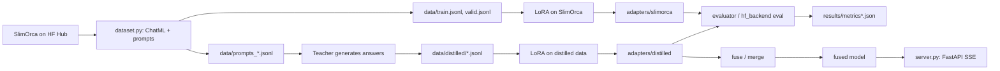

# QLoRA-Distill: Local LLM Fine-Tuning, Distillation & Adapter Fusion

[](https://github.com/shivangi911/peft-qlora-engine/actions)
[](https://www.python.org/)
[](https://github.com/ml-explore/mlx)
[](https://pytorch.org/)

An end-to-end, fully local pipeline that:

1. fine-tunes a model with **LoRA** (QLoRA-style when the base is 4-bit),
2. **distills** a larger teacher into the student (sequence-level distillation),
3. **evaluates** every variant (perplexity, peak memory, generation speed),
4. **fuses** the adapters into the base weights, and
5. **serves** the result over a streaming (SSE) FastAPI endpoint.

Two backends share the same data format and evaluation metrics:

| Backend | Hardware | Default models | Quantization |
| :--- | :--- | :--- | :--- |
| **MLX** (`trainer.py`, `distill.py`, …) | Apple Silicon | Qwen2.5-7B / 32B 4-bit | MLX affine 4-bit |
| **PyTorch** (`hf_backend.py`) | CPU, CUDA, MPS | Qwen2.5-0.5B / 1.5B (CPU demo); any HF causal LM | Optional **NF4 + double quantization** via `--quant4` (CUDA) |

It uses only open weights, open datasets and open-source libraries, and needs no cloud GPU.

---

## Table of contents
- [Architecture](#architecture)
- [Mathematical foundations](#mathematical-foundations)
- [Memory budget](#memory-budget)
- [Data pipeline](#data-pipeline)
- [Distillation](#distillation)
- [Repository layout](#repository-layout)
- [Setup and usage](#setup-and-usage)
- [Configuration](#configuration)
- [Streaming API](#streaming-api)
- [Results](#results)
- [Testing](#testing)
- [Design decisions and limitations](#design-decisions-and-limitations)

---

## Architecture

### Pipeline



### LoRA layer

```
                  Input x (k-dim)
                   │          │
        ┌──────────┘          └───────────┐
        ▼                                 ▼
 [ Frozen base W0 (d x k) ]       [ Trainable A (r x k) ]
   (optionally 4-bit)                     │
        │                                 ▼
        │                         [ Trainable B (d x r) ]
        │                                 │
        │                                 ▼
        │                         [ scale alpha / r ]
        │                                 │
        └──────────────► (+) ◄────────────┘
                          │
                      output h (d-dim)
```

### Components

| Module | Responsibility |
| :--- | :--- |
| `config.py` | Pydantic settings, overridable through env vars or `.env` |
| `dataset.py` | Streams SlimOrca, formats ChatML, writes train/valid JSONL and prompt files |
| `distill.py` | MLX teacher inference, resumable |
| `trainer.py` | MLX LoRA YAML config + `mlx_lm.lora` |
| `evaluator.py` | MLX perplexity, peak memory and tokens/sec |
| `fuser.py` | `mlx_lm.fuse` plus a NumPy reference merge |
| `hf_backend.py` | PyTorch train / distill / eval / merge (CPU, CUDA, MPS) |
| `server.py` | FastAPI app streaming tokens over Server-Sent Events |

---

## Mathematical foundations

### 1. Low-Rank Adaptation (LoRA)

For a frozen pretrained weight $W_0 \in \mathbb{R}^{d \times k}$, full fine-tuning learns a dense update $\Delta W \in \mathbb{R}^{d \times k}$. LoRA constrains the update to rank $r \ll \min(d,k)$:

$$\Delta W = \frac{\alpha}{r} B A, \qquad B \in \mathbb{R}^{d \times r}, \quad A \in \mathbb{R}^{r \times k}$$

$$h = W_0 x + \Delta W x = W_0 x + \frac{\alpha}{r} B A x$$

- **Initialization:** $A$ is random Gaussian and $B = 0$, so $\Delta W = 0$ at step 0 and training starts from the pretrained model.
- **Trainable parameters per adapted matrix:** $r(d+k)$ instead of $dk$. For $d = k = 4096$ and $r = 16$ that is $131{,}072$ versus $16{,}777{,}216$, about $0.8\%$.
- **Scaling:** the factor $\alpha / r$ keeps the update magnitude roughly constant when $r$ changes. This repo uses $r = 16$ and $\alpha = 32$, so the scale is $2$.
- **Gradients and optimizer state** exist only for $A$ and $B$.

### 2. Quantized base weights (QLoRA)

The frozen $W_0$ can be stored in 4-bit. During the forward pass each layer dequantizes its weights on the fly and applies the LoRA branch in higher precision.

In the original QLoRA paper the 4-bit format is **NormalFloat4 (NF4)**: 16 levels placed at quantiles of $\mathcal{N}(0,1)$,

$$q_i = \tfrac{1}{2}\left(Q_X\left(\tfrac{i}{16}\right) + Q_X\left(\tfrac{i+1}{16}\right)\right),$$

with **double quantization** that stores the per-block scales (block size 64) in 8 bits with a second-level block size of 256. Per-parameter metadata overhead drops from $32/64 = 0.5$ bits to

$$\frac{8}{64} + \frac{32}{64 \cdot 256} \approx 0.127 \text{ bits}.$$

Backend mapping:

- **PyTorch with `--quant4`:** uses `bitsandbytes` NF4 + double quantization (CUDA). This matches the paper.
- **MLX:** uses group-wise **affine** 4-bit quantization (`w ≈ scale * q + bias` per group). The LoRA math is identical; the quantizer is not NF4.

### 3. Adapter fusion

Matrix multiplication distributes over addition, so

$$W_0 x + \tfrac{\alpha}{r} B A x = \left(W_0 + \tfrac{\alpha}{r} B A\right) x = W_{\text{fused}} x.$$

`fuser.py` (MLX) and `hf_backend merge` (PyTorch) compute $W_{\text{fused}}$ once. `fuse_weights()` is a NumPy reference, and unit tests check that the fused output equals the adapter forward pass.

### 4. Training objective

Standard next-token cross-entropy over a ChatML sequence $x_{1:T}$:

$$\mathcal{L} = -\frac{1}{T-1}\sum_{t=1}^{T-1} \log p_\theta(x_{t+1} \mid x_{\le t}).$$

### 5. Perplexity

$$\text{PPL} = \exp\left(\frac{1}{N}\sum_{i=1}^{N} -\log p_\theta(x_i \mid x_{\lt i})\right)$$

Lower is better. Perplexity is computed over all tokens, including system and user text, with sequences truncated to a configured max length.

### 6. Sequence-level distillation

Instead of matching teacher logits, the student is trained with ordinary cross-entropy on text sampled from the teacher $p_T$:

$$\hat{y} \sim p_T(\cdot \mid x), \qquad \min_\theta -\log p_\theta(\hat{y} \mid x).$$

This approximates minimizing $\mathrm{KL}(p_T \Vert p_\theta)$ over sequences.

---

## Memory budget

Rough estimates for a 7B 4-bit model with rank 16:

| Component | Approx. size |
| :--- | :--- |
| 4-bit base weights | 4 to 5 GB |
| LoRA adapters (r=16) | tens of MB |
| Optimizer state (adapters only) | tens of MB |
| Activations (batch 4, seq 2048) | several GB |

The CPU demo below used a 0.5B student (~3–5 GB peak RSS) so it fits machines without a GPU.

---

## Data pipeline

- **Dataset:** [`Open-Orca/SlimOrca`](https://huggingface.co/datasets/Open-Orca/SlimOrca), streamed. Each row has a `conversations` list of `{from, value}` turns with roles `system`, `human` and `gpt`.
- **Format:** ChatML, which is the native format of the Qwen2.5 models.

```text
<|im_start|>system
You are an expert AI assistant that thinks step-by-step.<|im_end|>
<|im_start|>user
Write a function to implement binary search in Python.<|im_end|>
<|im_start|>assistant
Here is the binary search implementation...<|im_end|>
```

- **Split:** written to `data/train.jsonl` and `data/valid.jsonl` as `{"text": ...}` lines. Prompt files hold the system and first user message for the teacher.

---

## Distillation

1. Load a teacher (MLX: 32B 4-bit by default; PyTorch CPU demo: Qwen2.5-1.5B).
2. Apply the chat template to each prompt and generate answers.
3. Write ChatML rows immediately (resumable).
4. Fine-tune the student on the distilled JSONL with the same LoRA trainer.

---

## Repository layout

```text
peft-qlora-engine/
├── .github/workflows/ci.yml
├── scripts/run_cpu_demo.sh      # end-to-end PyTorch CPU demo
├── src/peft_engine/
│   ├── config.py
│   ├── dataset.py
│   ├── distill.py              # MLX
│   ├── trainer.py              # MLX
│   ├── evaluator.py            # MLX
│   ├── fuser.py
│   ├── hf_backend.py           # PyTorch
│   └── server.py
├── tests/
├── results/metrics_pytorch.json
├── Makefile
├── pyproject.toml
└── README.md
```

Generated and ignored by git: `data/`, `models/`, `logs/`. Commit measured metrics under `results/`.

---

## Setup and usage

Python 3.10+.

### Option A — Apple Silicon (MLX)

```bash
git clone https://github.com/shivangi911/peft-qlora-engine.git
cd peft-qlora-engine
python3.11 -m venv .venv && source .venv/bin/activate
pip install -e ".[mlx,dev]"
make smoke && make data && make train && make distill && make train-distilled && make eval
```

### Option B — Linux / CPU (PyTorch)

```bash
pip install -e ".[torch,dev]"
bash scripts/run_cpu_demo.sh
# or step by step:
python -m peft_engine.dataset --sample-size 300
python -m peft_engine.hf_backend train --iters 150 --batch-size 1 --max-len 256
python -m peft_engine.hf_backend distill --num-prompts 40
python -m peft_engine.hf_backend train --data-dir data/distilled_hf --adapter-dir models/hf_adapters/distilled --iters 150
python -m peft_engine.hf_backend eval --variant base= --variant slimorca_ft=models/hf_adapters/slimorca --variant distilled_ft=models/hf_adapters/distilled
```

On CUDA, add `--quant4` for NF4 + double quantization.

---

## Configuration

All fields in `config.py` can be set through environment variables or `.env`.

| Setting | Default | Description |
| :--- | :--- | :--- |
| `BASE_MODEL` | `mlx-community/Qwen2.5-7B-Instruct-4bit` | MLX student / base |
| `TEACHER_MODEL` | `mlx-community/Qwen2.5-32B-Instruct-4bit` | MLX teacher |
| `LORA_RANK` | 16 | Rank $r$ |
| `LORA_ALPHA` | 32.0 | Scaling numerator $\alpha$ |
| `LORA_DROPOUT` | 0.05 | Dropout on the adapter input |
| `LORA_LAYERS` | 16 | Number of transformer layers adapted (MLX) |
| `BATCH_SIZE` | 4 | Micro-batch size |
| `LEARNING_RATE` | 1e-4 | AdamW learning rate |
| `ITERS` | 1000 | Training iterations |
| `MAX_SEQ_LENGTH` | 2048 | Sequence truncation length |

---

## Streaming API

`POST /v1/chat/completions/stream` returns `text/event-stream`. Each event is `data: {"token": "..."}`, errors arrive as `data: {"error": "..."}`, and the stream ends with `data: [DONE]`.

```bash
curl -N -X POST http://localhost:8000/v1/chat/completions/stream \
  -H "Content-Type: application/json" \
  -d '{"prompt": "Explain the difference between QuickSort and MergeSort.", "max_tokens": 256}'
```

---

## Results

### PyTorch CPU demo (measured)

Hardware: Linux x86_64, 14 GB RAM, CPU only (no GPU).  
Student: `Qwen/Qwen2.5-0.5B-Instruct`. Teacher: `Qwen/Qwen2.5-1.5B-Instruct`.  
Data: 300 SlimOrca samples (270 train / 30 valid). Training: 150 LoRA steps, batch size 1, max length 256, rank 16, $\alpha$ 32. Distillation: 40 prompts. Metrics from [`results/metrics_pytorch.json`](results/metrics_pytorch.json).

| Variant | Perplexity (SlimOrca valid) | Peak RSS | Generation speed |
| :--- | ---: | ---: | ---: |
| Base 0.5B | 11.18 | 3.20 GB | 10.83 tok/s |
| + LoRA on SlimOrca | **5.06** | 3.49 GB | 9.89 tok/s |
| + LoRA on distilled data | 7.29 | 4.78 GB | 10.18 tok/s |

**Takeaways**
- SlimOrca LoRA cut validation perplexity by about **55%** relative to the base model.
- Distilled LoRA also improved over base, but less than direct SlimOrca fine-tuning on this metric, because it was trained on teacher text rather than SlimOrca answers. That is expected for sequence-level distillation evaluated on the original corpus.
- Trainable parameters were **8.8M / 503M (1.75%)**.

### Apple Silicon (MLX)

Not run yet. Fill from `results/metrics.json` after an M-series training pass.

---

## Testing

```bash
make lint   # ruff + mypy
make test   # unit + server tests (no GPU / MLX required)
```

Covered today: ChatML formatting, LoRA fusion math ($W_0 x + \tfrac{\alpha}{r} B A x$), training-config generation, perplexity helper, SSE server (mocked generator).

---

## Design decisions and limitations

- **Two backends:** MLX for Apple Silicon; PyTorch for CPU/CUDA so the pipeline is usable without a Mac.
- **Open models:** Qwen2.5 checkpoints need no gated-access approval.
- **NF4 is optional and CUDA-only** in the PyTorch path (`--quant4`). MLX uses affine 4-bit, not NF4.
- **Sequence-level distillation only:** there is no logit-level KL loss.
- **CPU demo is a proof of concept** on a 0.5B model. Scale the model and sample size on CUDA or Apple Silicon for production-sized results.
- **Evaluation is lightweight:** perplexity on a held-out SlimOrca slice and one speed prompt.
